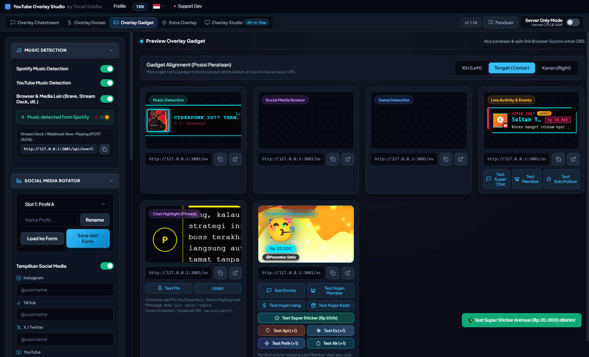
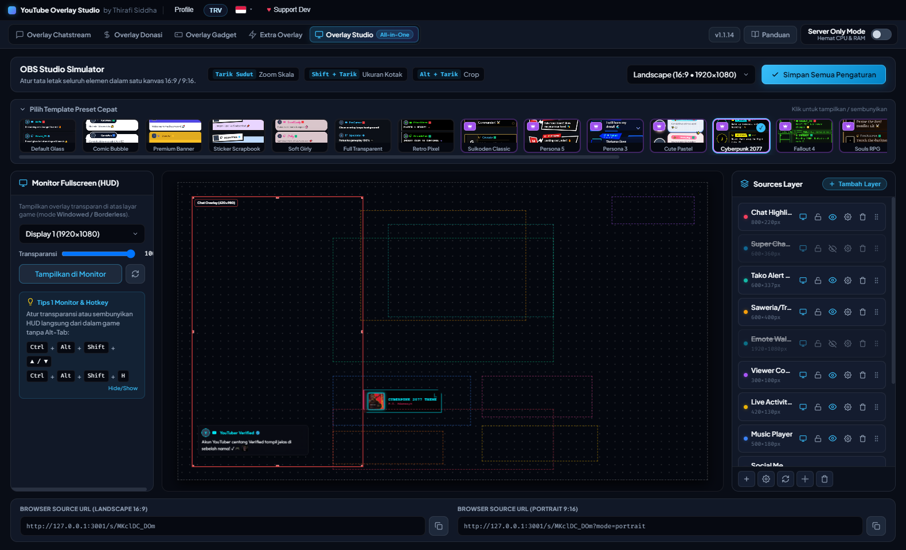
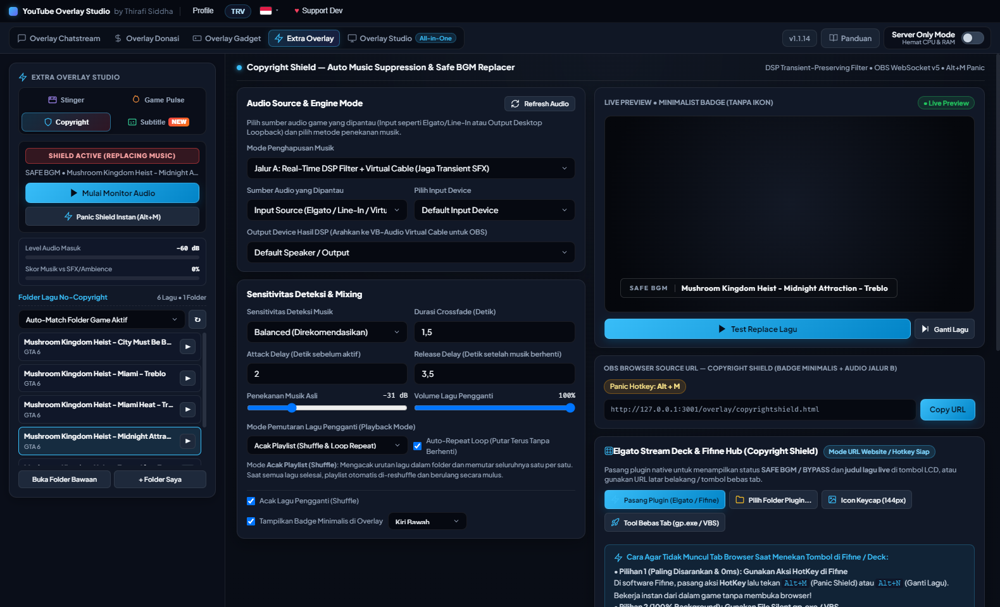
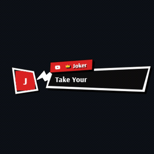
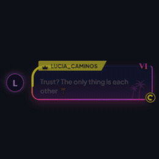
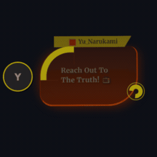
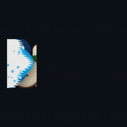
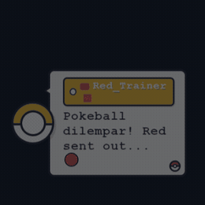

# YouTube Overlay Studio

**All-in-One Live Chat, Donation Alert, Game HUD, Stinger Transition, Copyright Shield & Hybrid Auto Subtitle untuk OBS Streamer**

*Dibuat oleh **Thirafi Siddha***

[⬇️ **Download Installer Terbaru (Windows .exe)**](https://github.com/thirafisiddha-ctrl/youtube-overlay-releases/releases/latest) · [📺 **Video Demo YouTube**](https://youtu.be/AGmcqtmTq5g) · [🐞 **Form Laporan Bug**](https://forms.gle/27QSHwnJWXuxpMDs6)

---

## 📺 Video Showcase

> **GUE BIKIN APLIKASI CHAT OVERLAY YOUTUBE, TIKTOK, TWITCH, KICK, ALL IN ONE MIRIP STREAMLABS** — *TRV - Have Fun Media*

*Klik gambar di atas untuk menonton demo lengkap di YouTube (`youtu.be/AGmcqtmTq5g`)*

---

## ✨ Fitur Unggulan

- **Multi-Platform Live Chat Overlay (Zero OAuth / Tanpa Login):** Gabungkan chat & viewer count real-time dari **YouTube, Twitch, Kick, dan TikTok** ke satu Browser Source OBS.
- **Overlay Donasi & Media Share:** Integrasi **Saweria**, **Tako (Webhook)**, **Trakteer**, serta deteksi native **Super Chat / Super Sticker / Bits / Gift**.
- **Overlay Gadget & Emote Wall:** Deteksi **Music Playing** (Spotify, YT Music, Browser, Stream Deck), **Social Media Rotator**, **Game Detection**, **Live Activity Pop-out**, **Pinned Chat Highlight**, & **Emote Wall** dengan reaksi elemen (🔥❄️⚡🌊).
- **Extra Overlay — Stinger Transisi 60fps:** Transisi WebM transparan VP9 Alpha + audio SFX bawaan siap tempel ke OBS Studio.
- **Extra Overlay — Game Pulse:** Counter & animasi sinematik otomatis (**Deaths, Kills, Boss Victory**) lengkap dengan **Mini Counter HUD**, **Auto Vision Micro-ROI / Valve GSI**, **Chat Crowd Trigger**, dan integrasi **Elgato Stream Deck / Fifine**.
- **Extra Overlay — Copyright Shield:** Sensor & ganti musik game berhak cipta secara real-time dengan playlist lagu no-copyright (Jalur DSP Virtual Cable atau OBS WebSocket v5) + Panic Hotkey `Alt+M`.
- **Extra Overlay — AI Hybrid Auto Subtitle (Mic + Game / OBS Source):** Mendukung **Sherpa-ONNX**, **Faster-Whisper (GPU CUDA / INT8)**, **Whisper.cpp**, **Vosk WASM**, dan 8 Cloud API, plus **pilih langsung Audio Source dari OBS Studio** untuk terjemahan suara Game terpisah & tetap berjalan saat aplikasi masuk System Tray.
- **Overlay Studio (All-in-One) + Monitor HUD 1 Layar:** Susun seluruh elemen dalam satu kanvas 16:9 / 9:16 OBS, plus mode **Fullscreen Transparan (HUD)** langsung di atas game *(Windowed/Borderless)*.
- **Multi-Bahasa & Auto-Update:** Pilihan bahasa UI lengkap (**Indonesia / English / 日本語**) dari dropdown bendera di titlebar + cek/pasang pembaruan otomatis via GitHub Releases.

---

## 🖥️ Screenshot Lengkap Semua Fitur (App UI)

### 1. Multi-Platform Overlay Chatstream & Live Preview + AI Designer
*Chat gabungan YouTube, Twitch, Kick, & TikTok lengkap dengan role badge (Owner, Moderator, Member, Verified, Super Chat), Viewer Count, & 20 tema preset.*

 

### 2. Overlay Donasi, Media Share & Native Super Chat
*Integrasi Saweria, Tako Webhook, Trakteer, serta Super Chat / Super Sticker / Bits & Gift native — lengkap dengan preview langsung & tombol uji notifikasi.*

 

### 3. Overlay Gadget, Pinned Chat Highlight & Emote Wall (Reaksi Elemen)
*Now Playing Spotify/YT Music, Rotator Sosmed, Game Detection, Live Activity Pop-out, Pinned Highlight, serta hujan emote & custom sticker kreator.*

 

### 4. Overlay Studio (All-in-One Canvas) & Monitor HUD 1 Layar
*Atur posisi, ukuran, opacity, Custom CSS/HTML/JS, dan susunan layer dalam satu Browser Source OBS 16:9 / 9:16 atau tampilkan langsung di atas game.*

 

### 5. Extra Overlay — Hybrid AI Auto Subtitle (Mic + Game / OBS Source Translation)
*Transkripsi real-time Mic Streamer + suara Game/Discord/OBS Source dengan bahasa terjemahan terpisah, Faster-Whisper CUDA, kontrol Stream Deck/Fifine, & mode Tray.*

 

### 6. Extra Overlay — Stinger Transisi OBS 60fps (VP9 Alpha + SFX)
*Preview langsung frame cut point (ms), cek transparansi checkerboard, dan salin lokasi file `.webm` untuk Scene Transitions OBS Studio.*

 

### 7. Extra Overlay — Game Pulse (Death / Kill / Boss Counter + Stream Deck)
*Visual banner sinematik (YOU DIED, GREAT ENEMY FELLED, Fire XL), Mini HUD 4 pojok, Micro-ROI/Valve GSI, Hotkey `Alt+F1..F3`, & plugin native Elgato/Fifine.*

 

### 8. Extra Overlay — Copyright Shield (Auto Music Suppression & Safe BGM)
*Deteksi BGM berhak cipta otomatis dengan DSP Virtual Cable (Jalur A) maupun OBS WebSocket v5 Auto-Duck/Mute (Jalur B) serta playlist pengganti bebas copyright.*

 

### 9. Multi-Bahasa (ID / EN / 日本語) & Pop-out Support Developer
*Dropdown bendera di titlebar untuk ganti bahasa seluruh UI secara instan serta tautan resmi dukungan developer (Website, Saweria, Tako Gift, GitHub Releases).*

---

## 🎨 Preset Tema Chatstream (Animasi GIF)

Beberapa contoh preset tema interaktif yang langsung siap pakai di aplikasi (termasuk badge Role Owner/Mod/Member & preset game favorit):

<table>
  <tr>
    <td align="center" width="33%">
       
      <b>Persona 5</b>
    </td>
    <td align="center" width="33%">
       
      <b>Cyberpunk 2077</b>
    </td>
    <td align="center" width="33%">
       
      <b>GTA VI Vice City</b>
    </td>
  </tr>
  <tr>
    <td align="center">
       
      <b>Persona 3 Reload</b>
    </td>
    <td align="center">
       
      <b>Persona 4 Revival</b>
    </td>
    <td align="center">
       
      <b>Valorant</b>
    </td>
  </tr>
  <tr>
    <td align="center">
       
      <b>Souls-like (Dark Souls)</b>
    </td>
    <td align="center">
       
      <b>One Piece (Mugiwara)</b>
    </td>
    <td align="center">
       
      <b>Pokémon Pixel</b>
    </td>
  </tr>
  <tr>
    <td align="center">
       
      <b>Suikoden Classic</b>
    </td>
    <td align="center">
       
      <b>Fallout 4 Pip-Boy</b>
    </td>
    <td align="center">
       
      <b>Cute Pastel Kawaii</b>
    </td>
  </tr>
</table>

---

## ⚡ Preset Stinger Transisi OBS (60fps Alpha + SFX)

Stinger WebM transparan siap pakai langsung di **OBS Studio → Scene Transitions → Stinger**:

<table>
  <tr>
    <td align="center" width="33%">
       
      <b>Persona 5</b>
    </td>
    <td align="center" width="33%">
       
      <b>Cyberpunk 2077</b>
    </td>
    <td align="center" width="33%">
       
      <b>Valorant</b>
    </td>
  </tr>
  <tr>
    <td align="center">
       
      <b>GTA VI</b>
    </td>
    <td align="center">
       
      <b>Persona 3 Reload</b>
    </td>
    <td align="center">
       
      <b>Souls-like</b>
    </td>
  </tr>
</table>

---

## ⬇️ Cara Install & Auto-Update

1. Buka halaman [**Releases**](https://github.com/thirafisiddha-ctrl/youtube-overlay-releases/releases/latest) dan unduh **`YouTube Overlay Setup X.X.X.exe`**.
2. Jalankan installer seperti biasa (`Windows x64`).
3. Untuk update berikutnya, Anda **tidak perlu cek manual** — aplikasi akan menampilkan notifikasi otomatis saat versi baru rilis (atau klik tombol versi di pojok kanan atas aplikasi).

---

## 🙌 Credits & Tentang Developer

Aplikasi ini dikembangkan oleh **Thirafi Siddha**. Terima kasih telah menggunakan aplikasi ini! Dukung terus pengembangannya melalui:

| Platform | Link |
| :--- | :--- |
| 🌐 **Website Resmi** | [thirafisiddha.netlify.app](https://thirafisiddha.netlify.app/) |
| 🟡 **Saweria** | [saweria.co/thirafisiddha](https://saweria.co/thirafisiddha) |
| 💙 **Tako Gift** | [tako.id/TRVsiddha/gift](https://tako.id/TRVsiddha/gift) |
| 🔴 **YouTube** | [Thirafi Siddha](https://www.youtube.com/@ThirafiSiddha) |
| 📸 **Instagram** | [@trv_cd](https://www.instagram.com/trv_cd/) |
| 🎮 **Indie Game Project** | [Silent Resonance (Itch.io)](https://trvansions.itch.io/silent-resonance-alpha) |
| 🐞 **Laporan Bug & Saran** | [Form Laporan Bug](https://forms.gle/27QSHwnJWXuxpMDs6) |
