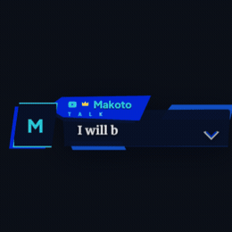
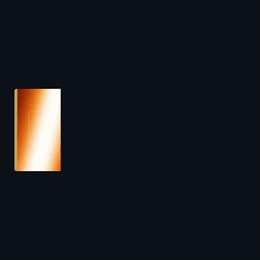
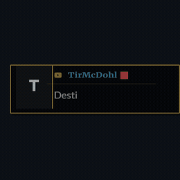
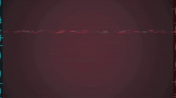

# YouTube Overlay Studio

**All-in-One Live Chat, Donation Alert, Game HUD, Stinger Transition & Hybrid Auto Subtitle untuk OBS Streamer**

*Dibuat oleh **Thirafi Siddha***

[⬇️ **Download Installer Terbaru (Windows .exe)**](https://github.com/thirafisiddha-ctrl/youtube-overlay-releases/releases/latest) · [📺 **Video Demo YouTube**](https://youtu.be/AGmcqtmTq5g) · [🐞 **Form Laporan Bug**](https://forms.gle/27QSHwnJWXuxpMDs6)

---

## 📺 Video Showcase

> **GUE BIKIN APLIKASI CHAT OVERLAY YOUTUBE, TIKTOK, TWITCH, KICK, ALL IN ONE MIRIP STREAMLABS** — *TRV - Have Fun Media*

*Klik gambar di atas untuk menonton demo lengkap di YouTube (`youtu.be/AGmcqtmTq5g`)*

---

## ✨ Fitur Unggulan

- **Multi-Platform Live Chat Overlay (Zero OAuth / Tanpa Login):** Gabungkan chat & viewer count real-time dari **YouTube, Twitch, Kick, dan TikTok** ke satu Browser Source OBS.
- **Overlay Donasi & Media Share:** Integrasi **Saweria**, **Tako (Webhook)**, **Trakteer**, serta deteksi native **Super Chat / Super Sticker / Bits / Gift** beserta Emote Wall.
- **Overlay Studio (All-in-One) + Monitor HUD 1 Layar:** Susun seluruh elemen (Chat, Alert, Emote Wall, Viewer Count, Now Playing) dalam 1 kanvas OBS, plus mode **Fullscreen Transparan (HUD)** langsung di atas game *(Borderless/Windowed)*.
- **AI Hybrid Auto Subtitle (Mic + Discord/App Audio):** Mendukung engine lokal **Sherpa-ONNX**, **Faster-Whisper (CUDA GPU/INT8)**, **Whisper.cpp**, **Vosk WASM**, dan 8 Cloud API (**ElevenLabs Scribe v2, Deepgram Nova-2, Groq, Gemini, OpenAI, AssemblyAI, Gladia, Fireworks**) lengkap dengan terjemahan real-time & tetap aktif di System Tray.
- **Extra Overlay Tools:** Stinger transisi transparan 60fps VP9+SFX, **Game Pulse** (deteksi Death/Kill/Victory + Elgato Stream Deck & Fifine), serta **Copyright Shield** anti-DMCA musik otomatis.
- **Auto-Update Bawaan:** Cek versi baru otomatis via GitHub Releases, download dalam aplikasi, dan pasang 1-klik.

---

## 🖥️ Tampilan Aplikasi (Visual App UI)

### 1. Multi-Platform Overlay Chatstream & AI Designer

 

### 2. Overlay Studio (All-in-One Canvas) & Monitor HUD 1 Layar

 

### 3. AI Auto Subtitle (Mic + Discord, Faster-Whisper CUDA & Stream Deck)

---

## 🎨 Preset Tema Chatstream (Animasi GIF)

Beberapa contoh preset tema interaktif yang langsung siap pakai di aplikasi (termasuk badge Role Owner/Mod/Member & preset game favorit):

<table>
  <tr>
    <td align="center" width="33%">
       
      <b>Persona 5</b>
    </td>
    <td align="center" width="33%">
       
      <b>Cyberpunk 2077</b>
    </td>
    <td align="center" width="33%">
       
      <b>GTA VI Vice City</b>
    </td>
  </tr>
  <tr>
    <td align="center">
       
      <b>Persona 3 Reload</b>
    </td>
    <td align="center">
       
      <b>Persona 4 Revival</b>
    </td>
    <td align="center">
       
      <b>Valorant</b>
    </td>
  </tr>
  <tr>
    <td align="center">
       
      <b>Souls-like (Dark Souls)</b>
    </td>
    <td align="center">
       
      <b>One Piece (Mugiwara)</b>
    </td>
    <td align="center">
       
      <b>Pokémon Pixel</b>
    </td>
  </tr>
  <tr>
    <td align="center">
       
      <b>Suikoden Classic</b>
    </td>
    <td align="center">
       
      <b>Fallout 4 Pip-Boy</b>
    </td>
    <td align="center">
       
      <b>Cute Pastel Kawaii</b>
    </td>
  </tr>
</table>

---

## ⚡ Preset Stinger Transisi OBS (60fps Alpha + SFX)

Stinger WebM transparan siap pakai langsung di **OBS Studio → Scene Transitions → Stinger**:

<table>
  <tr>
    <td align="center" width="33%">
       
      <b>Persona 5</b>
    </td>
    <td align="center" width="33%">
       
      <b>Cyberpunk 2077</b>
    </td>
    <td align="center" width="33%">
       
      <b>Valorant</b>
    </td>
  </tr>
  <tr>
    <td align="center">
       
      <b>GTA VI</b>
    </td>
    <td align="center">
       
      <b>Persona 3 Reload</b>
    </td>
    <td align="center">
       
      <b>Souls-like</b>
    </td>
  </tr>
</table>

---

## ⬇️ Cara Install & Auto-Update

1. Buka halaman [**Releases**](https://github.com/thirafisiddha-ctrl/youtube-overlay-releases/releases/latest) dan unduh **`YouTube Overlay Setup X.X.X.exe`**.
2. Jalankan installer seperti biasa (`Windows x64`).
3. Untuk update berikutnya, Anda **tidak perlu cek manual** — aplikasi akan menampilkan notifikasi otomatis saat versi baru rilis (atau klik tombol versi di pojok kanan atas aplikasi).

---

## 🙌 Credits & Tentang Developer

Aplikasi ini dikembangkan oleh **Thirafi Siddha**. Terima kasih telah menggunakan aplikasi ini! Dukung terus pengembangannya melalui:

| Platform | Link |
| :--- | :--- |
| 🔴 **YouTube** | [Thirafi Siddha](https://www.youtube.com/@ThirafiSiddha) |
| 📸 **Instagram** | [@trv_cd](https://www.instagram.com/trv_cd/) |
| 💛 **Donate / Traktir** | [tako.id/TRVsiddha](https://tako.id/TRVsiddha) |
| 🎮 **Indie Game Project** | [Silent Resonance (Itch.io)](https://trvansions.itch.io/silent-resonance-alpha) |
| 🐞 **Laporan Bug & Saran** | [Form Laporan Bug](https://forms.gle/27QSHwnJWXuxpMDs6) |
